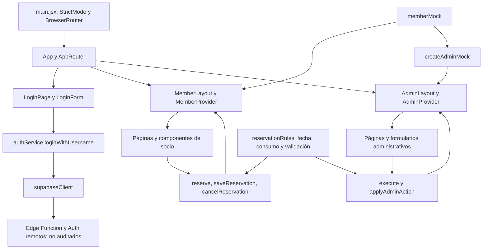

# Quebrando Cogos — Auditoría técnica

Fecha de referencia: 10 de noviembre de 2026, America/Montevideo.

## 1. Alcance y conclusión

La aplicación es una SPA React con dos demostraciones independientes (socio y administración) y un login que contiene llamadas reales al SDK de Supabase. No es todavía un sistema integrado de gestión del club. Ninguna funcionalidad de negocio puede calificarse como completa para producción con la evidencia disponible.

Se revisaron todos los archivos de texto de `src/`, `tests/`, `package.json`, `vite.config.js`, `index.html`, `.gitignore` y `README.md`. Se inspeccionaron las versiones instaladas y los metadatos de dependencias; no se auditó internamente el código de terceros. El inventario al final enumera cada archivo y sus símbolos. `PROJECT_SOURCE.md` reproduce íntegramente esos archivos, sin truncamientos. No existe `src/context/`: los contextos están en los componentes de cada área. No se encontraron instrucciones AGENTS.md dentro del proyecto ni en su directorio padre inmediato.

No se leyó ni reprodujo el contenido de `.env`. No se consultaron servicios remotos, no se inició sesión, no se modificaron datos de Supabase ni se instalaron dependencias. No se hicieron commits ni correcciones de código. La auditoría combina lectura estática, build, tests existentes y pequeñas ejecuciones de funciones puras en memoria. No hubo pruebas interactivas en navegador, de cámara, de accesibilidad, de despliegue ni de concurrencia real.

**Etiquetas de evidencia:** “lectura” describe comportamiento previsto por el código; “ejecutado” identifica verificaciones locales efectivamente realizadas; “no verificable” significa que faltan código o acceso al backend. Que el build pase no prueba que el login o una interacción de usuario funcionen.

## 2. Tecnologías y configuración

| Dependencia | Declarada | Instalada observada | Uso |
| --- | --- | --- | --- |
| React / React DOM | ^19.3.1 / ^19.3.1 | 19.3.1 / 19.3.1 | Componentes, hooks, contextos, montaje y renderizado de pruebas |
| react-router-dom | ^7.18.5 | 7.18.5 | BrowserRouter, rutas anidadas, navegación y Outlet |
| @supabase/supabase-js | ^2.119.0 | 2.119.0 | Edge Function de login y establecimiento de sesión |
| sweetalert2 | ^11.26.25 | 11.26.25 | Avisos, confirmaciones y ticket |
| Vite | ^8.3.6 | 8.3.7 | Desarrollo, compilación y carga SSR en tests |
| @vitejs/plugin-react | ^6.1.2 | 6.3.0 | Transformación de React |

JavaScript ES modules y JSX, CSS tradicional, sin TypeScript ni biblioteca de estado externa. Tests con `node:test`, `node:assert/strict` y `react-dom/server`. Entorno observado: Node v24.19.0, Windows/PowerShell. `npm.cmd ls --depth=0` terminó sin dependencias directas faltantes o inválidas. Esto no constituye un análisis de vulnerabilidades de paquetes.

`package.json` solo configura `dev`, `build` y `preview`; faltan scripts de tests, lint y comprobación de tipos. `vite.config.js` registra únicamente el plugin React. No hay configuración de proxy, aliases, base de subdirectorio ni alojamiento. `index.html` define español, viewport, título y el montaje `#root`.

`supabaseClient.js` obtiene `VITE_SUPABASE_URL` y `VITE_SUPABASE_PUBLISHABLE_KEY` y crea el cliente al importar el módulo. Se documentan exclusivamente nombres de variables, sin valores. No hay validación explícita de su presencia ni una pantalla para configuración incompleta. No existe `.env.example`. `.gitignore` excluye `.env`, `.env.local` y `.env.*.local`, pero no cualquier variante como `.env.production`.

No hay carpeta `supabase/`, migraciones SQL, definición de tablas, políticas RLS, funciones RPC, código de Edge Functions ni configuración de Storage. Su ausencia en este repositorio no demuestra que no existan en un proyecto remoto.

## 3. Estructura y arquitectura

```text
quebrandocogos/
├── .gitignore
├── .env                         [existencia observada; contenido excluido]
├── README.md
├── package.json
├── package-lock.json            [generado; excluido del volcado fuente]
├── index.html
├── vite.config.js
├── public/
│   ├── fondopantalla.png         [binario]
│   └── logoclub.png              [binario]
├── src/
│   ├── App.jsx
│   ├── main.jsx
│   ├── index.css
│   ├── Style/                   [Admin.css, Login.css, Member.css]
│   ├── components/
│   │   ├── LoginForm.jsx
│   │   ├── admin/               [layout, provider, UI, formularios, reservas, fotos, alertas]
│   │   └── member/              [layout, provider, catálogo, reservas, consumo, alertas]
│   ├── data/                    [adminMock.js, memberMock.js]
│   ├── pages/
│   │   ├── AdminPage.jsx
│   │   ├── LoginPage.jsx
│   │   ├── ReservasPage.jsx
│   │   ├── MemberProfilePage.jsx
│   │   ├── MemberInformationPage.jsx
│   │   └── admin/               [socios, ficha, stock, balance, configuración]
│   ├── router/                  [AppRouter.jsx]
│   ├── services/                [authService.js, supabaseClient.js]
│   └── utils/                   [adminRules.js, reservationRules.js]
├── tests/                       [memberRendering.test.js, reservationRules.test.js]
└── docs/                        [esta auditoría y PROJECT_SOURCE.md]
```

El inventario final completa las rutas individuales. `.git/`, `node_modules/` y `dist/` se excluyen del análisis de código de aplicación y del volcado. No se encontraron otros módulos de aplicación o backend.

### Composición y flujo de datos



La dependencia `adminMock → memberMock` reutiliza valores iniciales, no sincroniza estados. No hay flujo de reservas del socio hacia administración ni retorno de entregas al socio. El perfil devuelto por login solo decide navegación; no alimenta ninguno de los providers.

`MemberProvider` mantiene reservas y wizard con `useState`, y un contador local de IDs con `useRef`. Calcula reserva activa, stock visible y consumo; expone `useMember`. El formulario conserva su borrador y paso localmente. Al guardar, valida, reemplaza o agrega una reserva, cierra el wizard y muestra el ticket. Al cancelar, cambia el estado y conserva el registro histórico. Los mocks de miembro, configuración y ocupación no cambian.

`AdminProvider` inicializa con `createAdminMock()` mediante inicialización diferida, mantiene estado, administrador seleccionado y aviso. `execute` llama a `applyAdminAction`, genera UUID y actualiza una referencia al último estado antes de actualizar React. Esto evita operar sobre un estado local anterior en llamadas consecutivas, pero no es una transacción de base de datos. Los formularios reciben errores como cadenas y los muestran.

Los providers viven dentro de cada layout: conservan estado al navegar entre sus rutas hijas, pero lo pierden al recargar o desmontar el layout al abandonar el área, incluso sin cerrar la pestaña. No hay persistencia de negocio en localStorage, consultas, caché remota ni suscripciones Realtime.

### Rutas

Todas las rutas siguientes carecen de guardia de sesión y rol en el código.

| Ruta | Componente / función |
| --- | --- |
| `/` | LoginPage → LoginForm |
| `/reservas` | MemberLayout → ReservasPage: catálogo, información, consumo, reservas |
| `/reservas/perfil` | MemberProfilePage |
| `/reservas/informacion/:slug` | MemberInformationPage; slugs: preguntas-frecuentes, estatutos, terminos |
| `/admin` | AdminLayout → AdminPage |
| `/admin/socios` | AdminMembersPage |
| `/admin/socios/:memberId` | AdminMemberDetailPage; contempla socio no encontrado |
| `/admin/stock` | AdminStockPage |
| `/admin/balance` | AdminBalancePage |
| `/admin/configuracion` | AdminSettingsPage |
| `/admin/*` | Mensaje de sección no encontrada |

`/reservas#mis-reservas` es un ancla, no una ruta distinta. `MemberShell` desplaza al elemento por hash; ambos shells restablecen scroll al navegar. No hay catch-all global ni del área de socios. Las páginas de áreas se cargan con `lazy` bajo `Suspense`; no existe Error Boundary para fallos de carga o render. BrowserRouter requerirá una regla de fallback a index.html en el hosting; no se verificó ese hosting.

### Componentes reutilizables

Socio: `VarietyCard`, `ConsumptionIndicators`/`ConsumptionRing`, `MemberReservations`, `ReservationDetails`, `ReservationModal`, `memberAlert` y `showReservationTicket`. El ticket construye nodos con `textContent`, sin interpolar contenido del socio en HTML crudo.

Administración: `AdminIcon`, `AdminAvatar`, `AdminHeading`, `AdminBadge`, `AdminTable`, `AdminModal`, `AdminConsumption`, `matchesSearch`; `ReservationTable` y `ReservationDialog`; `MemberEditor`, `VarietyEditor`, `StockMovementForm`, `ExpenseForm` y `FormActions`; `AdminPhotoInput`; `adminAlert` y `confirmSimulation`.

Los modales usan `<dialog>` y bloqueo/restauración de scroll. Hay etiquetas, mensajes accesibles, foco visible, captions y ajustes de movimiento reducido. El wizard enfoca el título de cada paso. Esto se observó por lectura; no equivale a una auditoría de accesibilidad aprobada. El menú móvil administrativo no implementa foco atrapado ni cierre por Escape como un diálogo modal.

## 4. Funcionalidades

### A. Autenticación

| Función | Implementación observada | Integración / pendiente |
| --- | --- | --- |
| Login | `LoginForm.handleSubmit`: usuario/contraseña obligatorios, mostrar contraseña, loading y SweetAlert de error | Única entrada real a Supabase; login remoto no probado |
| Usuario normalizado | `loginWithUsername`: trim y minúsculas antes de invocar `login-with-username` | No se conoce cómo backend resuelve usuario a cuenta |
| Sesión | Espera `data.session`, pasa access_token y refresh_token a `auth.setSession`, devuelve `data.profile` | Solo código cliente disponible; sin provider de Auth ni manejo visible de expiración |
| Roles | `profile.role === 'admin'` navega a administración; cualquier otro valor a socio | No autoriza rutas, no valida rol desconocido ni perfil nulo |
| Alta y recuperación | Formulario administrativo y aviso de restablecimiento | Simulados; no crean usuarios Auth ni envían correo |
| Contraseñas | Input temporal administrativo; formulario de perfil deshabilitado | No se guarda contraseña temporal; no hay cambio inicial obligatorio ni recuperación real |
| Logout | Botón de socio deshabilitado; sin acción equivalente administrativa | Falta `auth.signOut` y limpieza de estado |

El contrato supuesto de Edge Function es `{session: {access_token, refresh_token}, profile: {role, ...}}` o un error. Los nombres de campos son código, no valores de credenciales. La validación de usuario, contraseña, rol, estado del socio, rate limiting y permisos del servidor no puede evaluarse sin la función. El cliente no consulta tablas con `.from`, ni invoca RPC de negocio o Storage.

### B. Área del socio

| Función | Qué existe por lectura | Datos / límites |
| --- | --- | --- |
| Catálogo | Dos tarjetas, fotos, características, precio UYU, stock y botón deshabilitado sin stock | `mockVarieties`; una variedad comienza sin stock. No consulta publicación administrativa |
| Reserva | Wizard de variedad, cantidad, fecha/turno y confirmación; ticket | Mutación de estado local, sin persistencia ni pago |
| Edición | Reutiliza ID y wizard, excluye su ID al comprobar reserva activa | Precio se vuelve a tomar del catálogo; no hay política documentada de cambios de precio |
| Cancelación | Confirmación, estado cancelled e historial | No hay evento de backend ni política de vencimiento/cancelación por hora |
| Historial | Completed y cancelled; importe estimado y fecha prevista | Las confirmadas vencidas siguen siendo activas; no hay proceso de expiración |
| Consumo | Suma gramos de entregas completed por deliveredAt, mensual y anual | No suma reservas pendientes; datos ficticios; pruebas unitarias locales aprobadas |
| Perfil | Identidad, contacto, dirección, fecha de ingreso y consumo | Siempre Alex Demo; solo lectura; cambio de contraseña deshabilitado |
| Información | FAQ y placeholders de estatutos/términos | Textos ficticios; sin publicación desde configuración |

El stock mostrado resta los gramos de la reserva activa propia. El wizard usa el stock base para permitir editar sin descontarse a sí mismo. La ocupación representa explícitamente a otros socios; no incluye la reserva propia ni se actualiza con operaciones locales. Es coherente como simulación de un único socio, insuficiente como sistema multiusuario.

### C. Administración

Todas las acciones de esta tabla operan únicamente en `AdminProvider`; ninguna persiste en Supabase.

| Módulo | Implementado por lectura | Incompleto / observaciones |
| --- | --- | --- |
| Dashboard | Totales, reservas del día, entregas pendientes globales, variedades publicadas, stock bajo, entregas realizadas hoy y búsqueda rápida | El total pendiente no enlaza una lista global; agenda incluye canceladas |
| Socios | Búsqueda por nombre/usuario/número/teléfono, filtro por estado, alta/edición, correlativo QC, ficha, foto, estado y consumo | No crea credenciales; sin eliminación, paginación o backend |
| Ficha | Reservas activas e historial, detalle de reserva, entrega y restablecimiento simulado | No recuperación real; no trazabilidad completa de cambios de datos/estado |
| Stock | Alta/edición/publicación de variedades; entrada, ajuste y compra; filtros e historial; umbral bajo | No comparte disponibilidad con socio; no contabiliza compromisos pendientes en stock libre |
| Entrega | Valida reserva pendiente, fecha no futura, socio activo, stock y límite; actualiza reserva, movimiento e ingreso juntos | Atomicidad solo en memoria; no comprueba hora del turno ni integridad completa del registro |
| Balance | Ingresos por entrega, gastos, compras vinculadas, saldo mensual, seis meses de gráfico, filtros de categoría/tipo y responsables | No pago, factura, banco, exportación, conciliación o reversión |
| Configuración | Nombre/contacto/dirección, horario/días/cupos, límites, umbral y textos | Límites y umbral se usan en admin; resto se guarda como borrador de sesión, sin publicar al socio |
| Identidad administrativa | Selector de tres administradores de ejemplo con mismos permisos | No vinculado a usuario Auth; responsable de movimiento es una elección del navegador |
| Fotos | JPG/PNG/WebP hasta 5 MB, FileReader, cámara/galería, preview y eliminación | Data URL en memoria; no subida ni validación servidor; cámara no probada |

### D. Reglas de negocio actuales

`reservationRules.js`:

- `clubClock`: zona America/Montevideo; `shiftDate` y `formatDate` usan mediodía UTC para fechas civiles; `money` redondea a cero decimales.
- `consumptionFor`: solo completed con deliveredAt <= fecha; mes y año calendario por prefijo. Saldo disponible es el mínimo entre remanente mensual y anual, nunca negativo. No es ventana móvil de 30/365 días.
- `availableSlots`: fecha válida y no pasada, día habilitado, horario definido; capacidad menos ocupación. En el día actual marca como pasado un turno cuyo inicio sea <= hora actual.
- `validateReservation`: una activa por conjunto recibido; variedad con stock; gramos enteros positivos y <= stock; saldo suficiente tanto hoy como en fecha de retiro; turno existente, futuro y no lleno.
- Configuración ficticia: 40 g/mes, 480 g/año, lunes a sábado, turnos de 10:00 a 17:00 y cuatro socios por turno. Son parámetros del código, no una afirmación de cumplimiento normativo.

`adminRules.js`, `applyAdminAction`:

- `save-member`: nombre/usuario/email requeridos, regex de email y usuario, teléfono/dirección no vacíos, estado válido, usuario/email únicos en la lista; campos permitidos explícitos; correlativo basado en máximo existente. No incluye contraseña en estado.
- `member-status`: existencia del socio y estado del enum; no cancela reservas pendientes.
- `save-variety`: nombre y descripción, precio finito positivo, nombre único ignorando mayúsculas, características normalizadas. `toggle-variety` cambia publicación; no verifica ID inexistente con error.
- `stockFor`: suma de movimientos, no del campo `variety.stock`. Entradas/compras positivas; ajustes pueden ser negativos; nunca saldo final negativo; fecha real no futura y motivo. Compra requiere costo positivo y agrega exactamente un gasto vinculado.
- `complete-delivery`: completed con deliveredAt del día actual, movimiento negativo e ingreso `grams * price`. Comprobar confirmed impide repetir la misma entrega en el estado local actual. No hay reversión ni pago procesado.
- `expense`: fecha válida no futura, concepto/categoría e importe positivo; prohíbe categoría Compras de stock para no duplicar el circuito de compra. No restringe otras categorías al catálogo en la función pura.
- `settings`: al menos un día válido, horas enteras y cierre posterior hasta 23:00, capacidad entera positiva, límites positivos y anual >= mensual, umbral >= 0. No verifica configuración contra reservas existentes; no es un esquema completo de entrada.

Los estados son active/suspended/inactive para socios y confirmed/completed/cancelled para reservas. No existe rejected, expired, no-show ni flujo de aprobación. Los datos del socio no tienen memberId ni enlace Auth; administración añade memberId a sus reservas. La configuración tiene formas diferentes: `mockConfig.schedule.hours` frente a `state.config.opening/closing/days/capacity`. No hay adaptador entre ambas.

## 5. Hallazgos priorizados

P0 = condición que debe resolverse antes de exponer datos reales; P1 = falta central para operación real; P2 = defecto funcional, robustez o verificación; P3 = mantenimiento o mejora menor. No se reporta una vulnerabilidad del backend remoto sin evidencia.

| ID | Prioridad y evidencia | Archivo / símbolo | Hallazgo, impacto y recomendación |
| --- | --- | --- | --- |
| A01 | P0 antes de producción; lectura | `src/router/AppRouter.jsx:AppRouter`, ambos layouts | Acceso directo sin sesión/rol. Hoy muestra mocks, no demuestra fuga de registros remotos. Implementar autorización de servidor/RLS y guardias de navegación antes de conectar información real. |
| A02 | P1; lectura / backend no verificable | `authService.js:loginWithUsername`, `LoginForm.jsx:handleSubmit`, providers | Identidad real se descarta tras navegar y los administradores se eligen en un selector. Falta contexto Auth, carga de perfil, rol/estado válido y atribución al actor autenticado. |
| A03 | P1; lectura | `MemberProvider.jsx`, `AdminProvider.jsx`, `memberMock.js`, `adminMock.js` | Negocio íntegramente simulado, estados separados y reinicio al desmontar. Alex tiene historiales distintos; Noche Violeta tiene 0 g para socio y 18 g para admin. Unificar contrato y fuente persistente antes de conectar CRUD. |
| A04 | P1; lectura | `MemberLayout.jsx:MemberShell`, `MemberProfilePage.jsx`, `AdminMemberDetailPage.jsx:resetAccess`, `AdminForms.jsx:MemberEditor` | Falta logout, alta Auth, recuperación y cambio de contraseña. Una sesión establecida carece de salida desde la UI. Implementar ciclo de acceso completo y distinguir cuentas de fichas. |
| A05 | P1 al integrar múltiples usuarios; lectura | `MemberProvider.jsx:saveReservation`, `reservationRules.js:validateReservation`, `adminRules.js:complete-delivery` | Stock, cupo y unicidad se comprueban solo contra arrays del navegador. Sin operación transaccional remota no hay garantía ante concurrencia; reservar no compromete stock administrativo. Definir stock físico/libre/reservado y hacer validación atómica en servidor. |
| A06 | P2; lectura | `src/services/supabaseClient.js:6`, `AppRouter.jsx` | Cliente creado sin validar variables; import estático de LoginPage hace depender incluso las rutas demo de inicialización Supabase. Configuración ausente o inválida puede impedir arranque. Agregar validación y error recuperable; no se provocó el fallo cambiando .env. |
| A07 | P2; lectura | `authService.js:loginWithUsername`, `LoginForm.jsx:handleSubmit` | Se valida session pero no profile ni rol; profile nulo puede causar TypeError luego de setSession; rol desconocido navega a socio. Error del SDK se sustituye por mensaje genérico y no se valida contrato. Validar respuesta y tratar sesión/perfil de forma coherente. |
| A08 | P2; ejecutado | `src/utils/adminRules.js:86`, `complete-delivery` | Una reserva de hoy a las 11:00 pudo completarse con reloj 00:01. Solo valida fecha. Decidir explícitamente si la entrega anticipada está permitida; si no, validar fecha y hora. |
| A09 | P2; ejecutado con estado sintético inválido | `src/utils/adminRules.js:86`, `complete-delivery` | No revalida gramos positivos/finitos/enteros ni precio positivo. Con grams=-8, stock pasó de 85 a 93 y se agregó ingreso -1440. No es alcanzable desde el wizard actual; sí evidencia dependencia de integridad previa. Validar registros y constraints de BD antes de integrar. |
| A10 | P2; ejecutado, política por decidir | `src/utils/reservationRules.js:63`, `validateReservation`; `ReservationModal.jsx` | Con 40 g consumidos en noviembre, reserva de 1 g para diciembre fue rechazada aunque diciembre tenga saldo. Se usa mínimo entre saldo de hoy y retiro. Confirmar intención y documentar política de reservas entre períodos. |
| A11 | P2; lectura | `src/data/memberMock.js:mockOccupancy`, `availableSlots` | Solo hay ocupación ficticia de 90 días; fuera de ese rango ausencia de dato significa turno vacío y no hay fecha máxima. No sirve para representar disponibilidad remota desconocida. Definir horizonte y distinguir no cargado de cero. |
| A12 | P2; lectura | `AdminPage.jsx:daily`, `AdminReservations.jsx` | Dashboard lista solo reservas con fecha de hoy; el total pendiente incluye otras fechas sin una lista global asociada. Vencidas se buscan por ficha de socio. Añadir vista de pendientes con filtros antes de operación real. |
| A13 | P2; ejecutado / lectura | `reservationRules.js:money`, `AdminForms.jsx:VarietyEditor/ExpenseForm/StockMovementForm` | Formularios aceptan centésimos, pero money(180.49) muestra $ 180. Sumas usan Number binario. Para balance real acordar precisión, usar representación monetaria consistente y mostrar decimales necesarios. |
| A14 | P2; lectura | `package.json`, `tests/` | Tests sin script; sin pruebas de adminRules, login, permisos, concurrencia, diálogos, edición/cancelación interactiva o integración. Agregar automatización y casos de invariantes antes de ampliar negocio. |
| A15 | P2; lectura | `src/router/AppRouter.jsx` | Sin 404 global/socio ni Error Boundary. Una URL fuera de las rutas puede mostrar área vacía; fallos de chunks o render no tienen recuperación propia. Añadir manejo según estrategia de producto. |
| A16 | P2; lectura | `src/data/*.js`, providers y `clubClock` | today/mes/ocupación se calculan al importar mocks; los indicadores se recalculan solo al render, sin temporizador. Una pestaña abierta al cambiar día/mes puede quedar desactualizada hasta otra interacción; fixtures no avanzan solos. Usar reloj reactivo o refresco por evento si necesario. |
| A17 | P3; lectura | `src/Style/Login.css:42`, `:204`, `:239` | Tres declaraciones de .login-logo; la última impone 170×170 también sobre regla móvil de 200×200 y desktop de 240×240. Consolidar reglas para eliminar overrides inadvertidos. `.login-submit span` no tiene span en el botón actual. |
| A18 | P3; ejecutado | Build / import estático de LoginForm y servicios | Bundle principal 560.57 kB minificado, advertencia >500 kB. Analizar composición y carga diferida con medición antes de optimizar; no se atribuye tamaño exacto a una dependencia sin análisis. |
| A19 | P3; lectura | `AdminUI.jsx:AdminConsumption`, `ConsumptionIndicators.jsx`, alertas y modales | Repetición conceptual de anillos, tema de alertas, diálogos y formularios visuales. No se hallaron componentes completos duplicados literalmente. Extraer solo piezas estables; mantener separación de dominio. |
| A20 | P3; lectura | `adminMock.js:varieties`, `adminRules.js:save-variety/stockFor` | Campo stock inicial en variedad coexiste con libro de movimientos y desaparece al editar variedad. La UI administrativa usa stockFor, por lo que no se observó fallo actual; eliminar ambigüedad en futuro contrato. |
| A21 | P3; lectura | `.gitignore`, `README.md` | Documentación inicial sin contrato backend ni setup seguro; cobertura parcial de variantes .env. Documentar configuración mediante placeholders y revisar exclusiones antes de compartir repositorio. No se publicaron valores. |

### Seguridad y límites adicionales

No se encontraron credenciales literales en los archivos fuente incluidos, con revisión y búsqueda de patrones comunes. `.env` se excluyó sin leer sus valores. Referencias a password, access_token y refresh_token en el código son variables/campos, no credenciales embebidas. Las fotos externas son URLs de ejemplo, no tokens. Nunca usar una clave privilegiada en variables que Vite expone al navegador.

Las restricciones HTML (required, min, max, type) ayudan a la UI, pero las funciones puras no validan todas las formas posibles de payload. Por ejemplo, `characteristics.map`, `payload.days.length` y `payload.limits.monthly` presuponen tipos; parámetros manipulados pueden lanzar errores, capturados en `execute`. No es prueba de explotación remota: no hay endpoint de estas acciones en el repositorio. Antes de crear uno deben existir esquemas, restricciones y permisos del lado servidor.

La atribución administrativa local no constituye una pista de auditoría confiable. Fotos Data URL no se validan por contenido ni se reducen de resolución; el límite de 5 MB por imagen no limita memoria total. Publicar fotos de socios requerirá diseño de permisos de Storage; no hay implementación disponible que auditar.

No se confirmó ningún error de sintaxis o importación que impida compilar el árbol actual. Tampoco se encontraron dependencias directas faltantes. No hay lint configurado ni análisis de CVE ejecutado, por lo que no se certifican ausencia de código muerto o vulnerabilidades de terceros. Las imágenes de public pesan aproximadamente 1.62 MB y 1.05 MB y se referencian desde CSS/layouts; optimización pendiente de medición. Las imágenes remotas carecen de fallback de error.

## 6. Verificaciones ejecutadas

### Build

PowerShell bloqueó `npm --version` por política de ejecución de `npm.ps1`; se usó el ejecutable `npm.cmd` sin cambiar esa política. No fue un fallo del proyecto.

Se ejecutó el script configurado de build, con argumentos que conservan el dist existente y evitan archivo temporal de configuración en el repositorio:

```powershell
$auditBuildDir = Join-Path $env:TEMP ('qc-audit-build-' + [guid]::NewGuid().ToString('N'))
npm.cmd run build -- --outDir $auditBuildDir --emptyOutDir false --configLoader runner
```

Resultado: exit 0, Vite 8.3.7, 104 módulos, build informado en 419 ms. Advertencia de chunk principal de 560.57 kB (160.63 kB gzip), mayor al umbral 500 kB. No hubo error de compilación. La variante de comando conserva plugin/configuración y cambia cargador de config y destino; no se ejecutó `npm run build` sin argumentos para no sobrescribir dist. Artefactos quedaron en un directorio temporal del sistema y no se incluyen en los documentos. No se muestran bundles porque incorporan configuración de entorno.

### Tests existentes

No hay script `test` en package.json. Se ejecutaron directamente ambos archivos mediante el runner que ya importan:

```powershell
node --test tests/reservationRules.test.js tests/memberRendering.test.js
```

Resultado: exit 0; 10 tests, 10 aprobados, 0 fallidos, 0 omitidos, duración total aproximada 1.25 s.

Nueve tests unitarios cubren reloj de Uruguay, consumo solo de completadas, fechas inválidas/pasadas/domingo, cupos/horas pasadas, reserva válida, cantidad/stock/saldo, una reserva activa y excepción para edición, turnos inválidos y límite anual/saldos no negativos. El décimo hace SSR de las vistas de socio con MemoryRouter y Vite, y comprueba textos de home/perfil/información/slugs desconocidos. No ejecuta useEffect, clicks, cámara, dialog.showModal ni conexión real a Supabase. No renderiza administración ni LoginForm.

Vite informó reoptimización de dependencias al ejecutar el test SSR; sus cachés temporales de herramienta no son código de aplicación ni se incluyeron. No se instalaron paquetes.

### Sondas en memoria

Se ejecutaron imports de `adminRules`, `reservationRules` y `createAdminMock` con `node --input-type=module`, sin escribir tests o código:

1. Entrega de ADM-0101 a las 00:01 del mismo día: completed, pese al turno 11:00 (A08).
2. Segundo intento sobre la misma reserva completada: rechazado, “Esta reserva ya no está pendiente de entrega.” Confirma la protección local contra doble entrega en secuencia; no prueba concurrencia remota.
3. Fixture clonado con grams=-8: stock 85 → 93 e ingreso -1440 (A09). Estado sintético, no datos reales.
4. money(180.49): visualización sin centésimos (A13).
5. Consumo de 40 g en noviembre y solicitud de 1 g el 1 de diciembre de 2026: rechazo por saldo de hoy (A10).

No se requiere repetir o ampliar estas verificaciones para afirmar más de lo aquí comprobado.

## 7. Recomendaciones y decisiones para la próxima etapa

1. Conservar la distinción demo/real y definir el alcance operativo: relación socio–Auth, roles, suspensión, entrega anticipada, vencimiento, política de cambios/cancelación, precios históricos, stock reservado y calendario de consumo. No inferir reglas legales de los valores mock.
2. Conseguir y revisar el esquema remoto, políticas RLS y Edge Function `login-with-username`; versionarlos cuando corresponda. El repositorio por sí solo no permite decidir si el backend actual es adecuado.
3. Implementar sesión/perfil/rol coherentes, logout, rutas protegidas y rechazo de roles desconocidos; mantener permisos obligatorios en servidor. Separar cuenta Auth de ficha del socio y definir alta/recuperación/cambio inicial.
4. Acordar contrato compartido: identificadores, memberId/Auth ID, estados, timestamps, zona horaria, precio por reserva, configuración de turnos, libro de stock y libro económico. El modelo sugerido es una propuesta, no tablas existentes confirmadas.
5. Diseñar transacciones remotas de reserva/edición/cancelación y entrega con unicidad, cupos, stock y límites verificados bajo concurrencia; garantizar idempotencia y vínculo entrega–movimiento–ingreso. Establecer reversión y trazabilidad en vez de editar totales manualmente.
6. Conectar providers mediante servicios de dominio y una fuente común. Definir estados de carga, error, refresco y conflicto, y persistencia; migrar primero un circuito vertical completo con pruebas, no pantallas aisladas que sigan discrepando.
7. Añadir tests de adminRules, contrato Auth, autorización y concurrencia; automatizar runner y build. Después probar flujos completos en navegador, móvil, teclado y cambios de fecha. Validar hosting y acceso directo a rutas.
8. Unificar precisión monetaria, revisar vencidas/404/errores, consolidar CSS y medir bundle/imágenes. Publicar documentos del club solo cuando los textos estén aprobados.

## 8. Estado de entrega documental

`PROJECT_SOURCE.md` es una instantánea textual completa de los archivos relevantes propios del proyecto. Incluye comentarios, JSX, CSS, mocks, pruebas y configuración; no es una reconstrucción resumida. El código sigue siendo la referencia; las recomendaciones de esta auditoría no fueron implementadas.

Se excluyen explícitamente `.env` y cualquier archivo de secretos, lockfile generado, `.git`, dependencias instaladas, dist/cachés/compilados, imágenes binarias y los propios documentos para evitar recursión. No había `.env.example` para incluir. Los binarios permanecen referenciados por sus rutas; para ejecutar el proyecto fuera del repositorio habrá que disponer de ellos y configurar el entorno de forma privada. El volcado no reemplaza una entrega reproducible con lockfile y assets.

El estado inicial de Git mostraba los archivos del proyecto como no rastreados. No se añadieron al índice ni se creó ningún commit. Solo se escribieron como entregables `docs/PROJECT_AUDIT.md` y `docs/PROJECT_SOURCE.md`.

## 9. Inventario preciso de archivos analizados

La tabla siguiente se genera del árbol de archivos revisado. Los símbolos incluyen funciones/componentes y exports; los números corresponden a las líneas del archivo original. CSS, configuración y documentación se identifican por su ruta y contenido completo en PROJECT_SOURCE.md.

| Archivo | Líneas | Símbolos / referencias |
| --- | ---: | --- |
| `.gitignore` | 27 | Texto completo en PROJECT_SOURCE.md |
| `README.md` | 15 | Texto completo en PROJECT_SOURCE.md |
| `index.html` | 12 | Texto completo en PROJECT_SOURCE.md |
| `package.json` | 22 | Texto completo en PROJECT_SOURCE.md |
| `src/App.jsx` | 8 | `App:4` |
| `src/Style/Admin.css` | 274 | Texto completo en PROJECT_SOURCE.md |
| `src/Style/Login.css` | 292 | Texto completo en PROJECT_SOURCE.md |
| `src/Style/Member.css` | 264 | Texto completo en PROJECT_SOURCE.md |
| `src/components/LoginForm.jsx` | 133 | `LoginForm:7` |
| `src/components/admin/AdminForms.jsx` | 117 | `FormActions:9`, `MemberEditor:13`, `VarietyEditor:45`, `StockMovementForm:70`, `ExpenseForm:95` |
| `src/components/admin/AdminLayout.jsx` | 45 | `AdminShell:15`, `AdminLayout:45` |
| `src/components/admin/AdminPhotoInput.jsx` | 25 | `AdminPhotoInput:3` |
| `src/components/admin/AdminProvider.jsx` | 28 | `useAdmin:6`, `AdminProvider:8` |
| `src/components/admin/AdminReservations.jsx` | 40 | `ReservationTable:8`, `ReservationDialog:20` |
| `src/components/admin/AdminUI.jsx` | 58 | `AdminIcon:4`, `AdminAvatar:15`, `AdminHeading:22`, `AdminBadge:26`, `AdminTable:30`, `AdminModal:34`, `AdminConsumption:46`, `matchesSearch:55` |
| `src/components/admin/adminAlerts.js` | 10 | `adminAlert:3`, `confirmSimulation:7` |
| `src/components/member/ConsumptionIndicators.jsx` | 24 | `ConsumptionRing:3`, `ConsumptionIndicators:15` |
| `src/components/member/MemberLayout.jsx` | 53 | `MemberShell:6`, `MemberLayout:51` |
| `src/components/member/MemberProvider.jsx` | 90 | `useMember:9`, `MemberProvider:13` |
| `src/components/member/MemberReservations.jsx` | 38 | `MemberReservations:6` |
| `src/components/member/ReservationDetails.jsx` | 13 | `ReservationDetails:3` |
| `src/components/member/ReservationModal.jsx` | 133 | `ReservationModal:7` |
| `src/components/member/VarietyCard.jsx` | 24 | `VarietyCard:3` |
| `src/components/member/memberAlerts.js` | 32 | `memberAlert:4`, `showReservationTicket:11` |
| `src/data/adminMock.js` | 62 | `mockAdministrators:7`, `expenseCategories:42`, `createAdminMock:44` |
| `src/data/memberMock.js` | 76 | `mockMember:7`, `mockConfig:14`, `mockVarieties:23`, `mockOccupancy:41`, `mockReservations:45`, `clubInformation:51`, `informationPages:58` |
| `src/index.css` | 3 | Texto completo en PROJECT_SOURCE.md |
| `src/main.jsx` | 15 | Texto completo en PROJECT_SOURCE.md |
| `src/pages/AdminPage.jsx` | 45 | `AdminPage:9` |
| `src/pages/LoginPage.jsx` | 26 | `LoginPage:4` |
| `src/pages/MemberInformationPage.jsx` | 14 | `MemberInformationPage:4` |
| `src/pages/MemberProfilePage.jsx` | 32 | `MemberProfilePage:6` |
| `src/pages/ReservasPage.jsx` | 32 | `ReservasPage:7` |
| `src/pages/admin/AdminBalancePage.jsx` | 57 | `MonthlyChart:10`, `AdminBalancePage:25` |
| `src/pages/admin/AdminMemberDetailPage.jsx` | 44 | `AdminMemberDetailPage:11` |
| `src/pages/admin/AdminMembersPage.jsx` | 26 | `AdminMembersPage:8` |
| `src/pages/admin/AdminSettingsPage.jsx` | 46 | `AdminSettingsPage:7` |
| `src/pages/admin/AdminStockPage.jsx` | 41 | `AdminStockPage:10` |
| `src/router/AppRouter.jsx` | 49 | `AppRouter:19` |
| `src/services/authService.js` | 30 | `loginWithUsername:3` |
| `src/services/supabaseClient.js` | 6 | `supabase:6` |
| `src/utils/adminRules.js` | 121 | `memberStatuses:3`, `reservationStatuses:4`, `requireValue:6`, `validDate:10`, `positiveAmount:15`, `nextMemberNumber:17`, `stockFor:21`, `financialSummary:25`, `applyAdminAction:33` |
| `src/utils/reservationRules.js` | 69 | `CLUB_TIME_ZONE:1`, `clubClock:3`, `shiftDate:11`, `formatDate:17`, `money:22`, `consumptionFor:26`, `availableSlots:40`, `validateReservation:53` |
| `tests/memberRendering.test.js` | 41 | Texto completo en PROJECT_SOURCE.md |
| `tests/reservationRules.test.js` | 79 | Texto completo en PROJECT_SOURCE.md |
| `vite.config.js` | 7 | Texto completo en PROJECT_SOURCE.md |

Total: **46 archivos fuente/configuración/documentación inicial**, 2698 líneas. Los dos PNG se inventariaron por nombre/tamaño; package-lock.json se excluyó como archivo generado.
